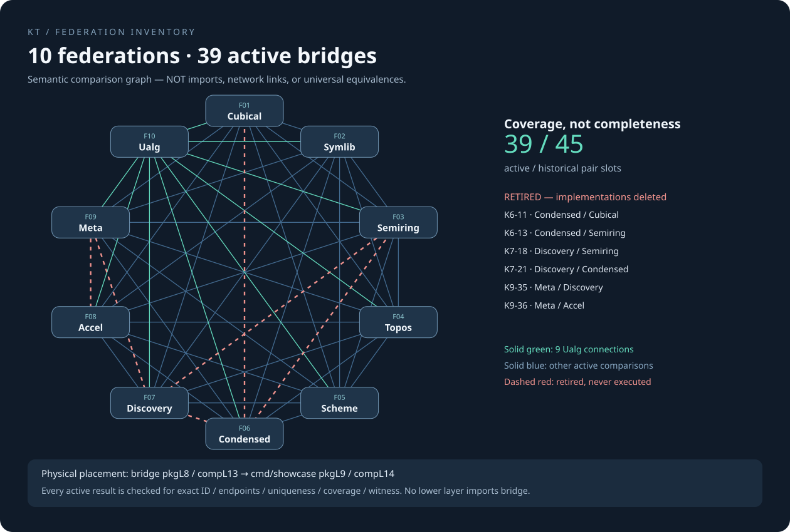

# 全局聯邦與實體分層

> 自動產生：`python3 tools/federation_docs.py`。實體圖來源 `architecture.json`；語義橋來源 `bridge/catalog.json`。

## 先分清三張圖

1. **Package import DAG**：箭頭由 provider 指向 consumer；每次 import 向較低 package layer，禁止底層回匯 `bridge`。
2. **Component DAG**：同一實體 package 可以包含數個邏輯層，不能把 component L4 當成 package L4。
3. **語義橋圖**：無向邊表示一個有界跨表示核驗，不是 import、網路連線、分散式節點，也不是無條件數學等價。按聯邦收縮 package 圖可出現雙向依賴，不能將其誤稱為聯邦 DAG。

當前：**10 聯邦 + observer 頂點、57 packages、66 components、327 `.mbt` 檔、204,558 行**。
歷史 45 配對中 **39 active、6 retired**。這是 K₁₀ 的子圖，不是完全圖。

## 每層住甚麼

| Package layer | 套件數 | 實際套件 |
|---|---:|---|
| L0 | 7 | `gcd`, `symlib/core`, `cubical/face_bdd`, `meta/core`, `accel/swar`, `ualg/core`, `ualg/site` |
| L1 | 13 | `algebra/core`, `cubical/finite`, `symlib`, `semiring/algebra`, `semiring/nf`, `semiring/ratelimit`, `semiring/sim`, `semiring/par`, `hostfs`, `meta/instances`, `meta/iit`, `condensed/core`, `ualg/demorgan` |
| L2 | 13 | `algebra`, `cubical/kernel`, `cmd/symdemo`, `cmd/symbench`, `semiring/matrix`, `semiring/monoid`, `semiring/trop`, `semiring/bp`, `semiring/io`, `tensor`, `meta/reflect`, `topos/site`, `ualg/cube` |
| L3 | 12 | `cubical/hermitian`, `cubical/elaborator`, `cubical/homotopy`, `cubical/store`, `semiring/graph`, `semiring/spline`, `semiring/cat`, `topos`, `scheme`, `cmd/metatheory`, `conjecture/kernel`, `cmd/ualg` |
| L4 | 4 | `semiring/app`, `condensed`, `semiring/par_host`, `accel` |
| L5 | 3 | `cubical/autonomy`, `conjecture`, `cmd/semiringreport` |
| L6 | 1 | `cubical/structures` |
| L7 | 1 | `.` |
| L8 | 2 | `cmd/main`, `bridge` |
| L9 | 1 | `cmd/showcase` |

L0 有 7 個業務基礎套件；不是只得五個。`hostfs` 及部分 semiring 原語雖無倉內依賴，仍按職責編配 L1：layer 是治理分級，不必等於最短拓撲深度。

## 十聯邦職責與所在層

| 聯邦 | 套件數 | Package layers | 職責 |
|---|---:|---|---|
| F1 `cubical` | 14 | L0, L1, L2, L3, L5, L6, L7, L8 | 第一聯邦 — 立方依賴型別論、計算性單值性、ROBDD 面格、Hermitian 譜投影、精確代數塔與 BFT／MVCC 持久執行。 |
| F2 `symlib` | 4 | L0, L1, L2 | 第二聯邦 — 有限對稱群、著色規範標號、Burnside 標記、G-集、有限範疇與 Kan 擴張。 |
| F3 `semiring` | 16 | L1, L2, L3, L4, L5 | 第三聯邦 — 冪等／星閉／熱帶半環代數、分塊／Lehmann 矩陣閉包、加權 CSR 圖與 Brzozowski DFA 正規形。 |
| F4 `topos` | 2 | L2, L3 | 第四聯邦 — Grothendieck 與初等 Topos、子 Topos Lawvere–Tierney 核、Kripke–Joyal 力迫、群胚疊與神經上同調。 |
| F5 `scheme` | 1 | L3 | 第五聯邦 — 多變量 Gröbner 理想、Zariski 黏合概形、Kähler 微分與 Eisenbud Fitting 平滑性、Serre 對偶、吹脹與 Chow 動機。 |
| F6 `condensed` | 3 | L0, L1, L4 | 凝聚有限模型與精確消元：有限逆系塔、solid/liquid 報告、截斷 Adams Ext、Serre/AHSS、P¹ Laurent Čech 維數、規範商與不變量賬本。舊名 CondAnalyticStack 不是已構造的解析棧，亦不宣稱 X 交換性。 |
| F7 `discovery` | 3 | L2, L3, L5 | 第七聯邦（多線性張量場論與 Lakatos 猜想演化創造聯邦） — F_3 全體 6,561 張量超行列式與秩圖譜、有限平面離散 Radon 反演、Clifford 拉蒙旋量與 T² 規範模空間、非交叉森林層景、VR 持續同調、6 大演化轉移定律、5 大認識論透鏡與 7 項已決猜想。 |
| F8 `accel` | 2 | L0, L4 | 第八聯邦（CPU SWAR 與瀏覽器免費 WebGPU 前沿硬體加速聯邦） — L0 零依賴 SWAR 硬體底層（`accel/swar`）、M4RI GF(2) 格雷碼矩陣乘與行最簡消元、雙軌 64-trit GF(3) 位切片全體 6,561 張量超行列式掃描、64 路 Face 超立方體 #SAT、Ozaki Scheme II INT8 DP4A 中國剩餘定理精確／FP64 矩陣乘、32 位 RNS Stockham 免位反轉 NTT 與 30 位 Montgomery 規約、Scanbox 解耦回看前綴掃描、三相無衝突共享記憶體熱帶 Kleene 閉包、HVM2 扁平競技場並行交互組合子與閉合 Peano λ 求值器，以及 8 個經靜態可移植性審計之 W3C 瀏覽器 WebGPU WGSL 計算著色器。 |
| F9 `meta` | 5 | L0, L1, L2, L3 | 第九聯邦 — 元理論：以序數／擬陣／Ramsey／複形為數學底層；全域實例的一致性與下降黏合；索引為項的歸納-歸納型別；可重放憑證的反射。 |
| F10 `ualg` | 5 | L0, L1, L2, L3 | 第十聯邦 — 構造性泛代數 × 預層模板 × De Morgan 立方體：同餘格與商代數（Freese 閉包對暴力列舉）、Mal'cev 項的三個演算法、零元／吸收元與 Rees 商、Galois 連接（Fix ⊣ Stab、Mod ⊣ Th，NextClosure）、平移算子的譜；Alexandrov 景、Lawvere–Tierney 核子、雙重否定層化作為以計數驗證的左伴隨；自由 De Morgan 代數 DM(n) 與 Kalman 正規形、De Morgan 立方體範疇及其自同構群 B_n、仿射（read-once）片段、面格與 ∃ ⊣ w ⊣ ∀、開盒／懸掛／推出／環面的立方同調，以及 Hodge Laplace 譜。 第二輪新增 ualg/cube：立方體上的雙重否定核子（面 Heyting 代數上的 j = ¬¬、Glivenko：Fix(¬¬) ≅ P(頂點)）與立方體上的層化（Sh_¬¬(□ⁿ) ≃ Set^{頂點}、a(F)(x) = ∏_{v≤x}\|F(v)\|、子終層 = 正則子複形、層化只經由頂點決定）。 |

## 57 個實體套件：位置、擁有者、直接依賴

完整 provider → consumer 圖：[package-dependencies.mmd](package-dependencies.mmd)。以下列出每條 import；無省略邊。

| Package / 路徑 | 聯邦 | pkgL / compL | 直接依賴 | 職責 |
|---|---|---|---|---|
| `accel-swar` / `accel/swar` | accel | L0 / 0 | — | L0 零依賴 64 位 SWAR 與硬體底層：M4RI GF(2) 矩陣乘／RREF、雙軌 GF(3) 64-trit 超行列式掃描、64 路 Face #SAT、Ozaki-II INT8 DP4A CRT 矩陣乘、32 位 RNS Stockham NTT 與 Montgomery 規約、Scanbox／Morton 前綴掃描、HVM2 扁平競技場交互網路與 Peano 求值器，以及雙 Heyting 篩。 |
| `cubical-face-bdd` / `cubical/face_bdd` | cubical | L0 / 0 | — | Kalman 雙軌自由 De Morgan 區間 I_DM、自由 CCHM 上纖維化格 Cofib(n)、64 位 UInt64 SWAR 真值快徑、規範／DAG ROBDD、雙監視字元 CDCL（DRUP／DRAT／LRAT 證書）與前沿割寬 #SAT。 |
| `gcd` / `gcd` | condensed | L0 / 0 | — | 下V頂點 V_1：整數、F_p[x] 多項式、F_p 子空間、ℤ-格（Hermite／Smith 範式）與多生成元 Bézout 主理想之泛消元新最大公因數。 |
| `meta-core` / `meta/core` | meta | L0 / 0 | — | 數學結構底層：Cantor 範式序數、精確有理數矩陣秩、一階合一／MGU 與反合一、擬陣（秩／貪心／對偶）、Ramsey 搜尋、有限複形與 Čech 神經上同調。 |
| `symlib-core` / `symlib/core` | symlib | L0 / 0 | — | L0 零依賴對稱核心：64-bit SWAR 位向量、無度數上限 PermLut、Schreier–Sims 置換群、個體化精煉搜索引擎與圖自同構群。 |
| `ualg-core` / `ualg/core` | ualg | L0 / 0 | — | 有限表格代數上的構造性泛代數：項與恆等式、子代數／積／自由代數閉包、同餘生成與同餘格、商代數與同構定理、Mal'cev 項搜尋（全域、自反對稱、冪等局部）、零元／吸收元、理想與 Rees 商、極性與 NextClosure、Fix ⊣ Stab 與 Mod ⊣ Th 的 Galois 對應、平移算子的精確特徵多項式。 |
| `ualg-site` / `ualg/site` | ualg | L0 / 0 | — | 有限偏序上的預層模板：Alexandrov 拓撲與開集的 Heyting 代數、核子（Lawvere–Tierney 拓撲）普查與 Isbell 稠密性定理、雙重否定 j = ¬¬、預層、匹配族、j-層條件、plus 構造與帶單位的層化，並以自然變換計數驗證伴隨 a ⊣ i。 |
| `algebra-core` / `algebra/core` | cubical | L1 / 1 | `gcd`, `accel-swar` | L1 精確代數核心層：任意精度有理數（Rat）、單變量／符號多項式（Poly、QPoly），以及具備 Int64 快徑、Ozaki-II INT8 DP4A 多素數 CRT 矩陣乘與無分數 Bareiss 行列式之 QMat 線性代數。 |
| `condensed-core` / `condensed/core` | condensed | L1 / 2 | `gcd`, `accel-swar` | L1 凝聚與同倫核心：有限／緊緻射影極限塔、構造性 Nöbeling 單模基底、固態與 p-液態模、Roos–Milnor R¹lim 與 64-bit @swar Steenrod–Adams 極小分解。 |
| `cubical-finite` / `cubical/finite` | cubical | L1 / 1 | `cubical-face-bdd` | 簡單型別 η-NbE／HOAS，以及 Bool／Unit／積有限宇宙的 wiring 等價、ua、PathP、Glue 與 J。 |
| `hostfs` / `hostfs` | cubical | L1 / 2 | — | 宿主儲存後端接縫：崩潰一致寫入的可執行模型（內容 fsync 先於目錄項 fsync）、lock／write／fsync／rename／fsync 目錄協定，以及可在所有目標上執行的崩潰點一致性檢核。 |
| `meta-iit` / `meta/iit` | meta | L1 / 1 | `meta-core` | 歸納-歸納型別：索引為項的 schema、相依索引檢查、切片塔 Kleene 不動點、滿足 ι 律的互遞迴消除器、序數終止憑證；Nat/Fin、Even/Odd 與 STLC 的 Ctx/Ty/Tm。 |
| `meta-instances` / `meta/instances` | meta | L1 / 1 | `meta-core` | 全域實例（typeclass）作為 Horn 解析：SLD＋MGU、序數終止度量、臨界對一致性、可導性擬陣與極小實例基、Čech／下降黏合與單值化障礙、鏡像對偶、Ramsey 深度窗口。 |
| `semiring-algebra` / `semiring/algebra` | semiring | L1 / 1 | — | 半環、冪等／星閉／熱帶半環與么半群 traits、具體載體、定律檢察器與運算計數。 |
| `semiring-nf` / `semiring/nf` | semiring | L1 / 1 | — | 正則表達式／DFA 與自由冪等半環正規形。 |
| `semiring-par` / `semiring/par` | semiring | L1 / 1 | — | 分塊聚合與分片 I/O 的可移植後端接縫。 |
| `semiring-ratelimit` / `semiring/ratelimit` | semiring | L1 / 1 | — | GCRA 限流應用套件。 |
| `semiring-sim` / `semiring/sim` | semiring | L1 / 1 | — | 時間、快取與記憶階層量測模型。 |
| `symlib` / `symlib` | symlib | L1 / 2 | `symlib-core` | 有限對稱：圖規範形、自同構群、有限範疇、預層、G-集與可執行證書。 |
| `ualg-demorgan` / `ualg/demorgan` | ualg | L1 / 1 | `ualg-core`, `ualg-site` | De Morgan 立方體：以反鏈正規形表示的自由 De Morgan 代數 DM(n)、Kalman 的 𝟜-語義與 Dedekind 數、De Morgan 立方體範疇（代換、立方恆等式、Aut = B_n）、以 Gurvich 判準刻畫的仿射 read-once 片段、作為商與作為子複形的面格 𝔽(n) 及量詞 ∃ ⊣ w ⊣ ∀、立方鏈複形（開盒、懸掛、推出、Künneth、環面）、Hodge Laplace 譜，以及正方形對稱群的 Galois 對應。 |
| `algebra` / `algebra` | cubical | L2 / 2,3 | `gcd`, `algebra-core` | 精確有理／代數計算：符號多項式、Q 線性代數、代數數、Jordan 理論、譜恆等、認證 Jacobi 區間、Liouville 超越否證證書與無除法 Berkowitz–CRT 特徵多項式。 |
| `cmd-symbench` / `cmd/symbench` | symlib | L2 /  | `symlib` | 有限對稱 Benchmark 執行入口。 |
| `cmd-symdemo` / `cmd/symdemo` | symlib | L2 /  | `symlib` | 有限對稱展示執行入口。 |
| `cubical-kernel` / `cubical/kernel` | cubical | L2 / 4,5 | `cubical-face-bdd`, `cubical-finite` | 可信立方依賴核心：依賴 NbE、AST Kan 運算、Glue 等價、密封受檢線 CheckedLine／CheckedDCube、DSystem 相容性、歸納／HIT／開放歸納遞迴 Schema 與 Cantor／Mahlo 序數。 |
| `meta-reflect` / `meta/reflect` | meta | L2 / 2 | `meta-core`, `meta-instances` | 反射：NbE 的 reify／reflect 伴隨、可獨立重放的 βη 憑證、可判定保守性的宇宙反射與 Mahlo 式極限反射、實例推導反射成無需搜尋的憑證。 |
| `semiring-bp` / `semiring/bp` | semiring | L2 / 2 | `semiring-algebra` | 因子圖上的半環信念傳播。 |
| `semiring-io` / `semiring/io` | semiring | L2 / 2 | `semiring-algebra` | 邊表剖析與合成圖輸入生成。 |
| `semiring-matrix` / `semiring/matrix` | semiring | L2 / 2 | `semiring-algebra`, `semiring-par`, `accel-swar` | 半環係數泛型稠密／CSR 矩陣、分塊核與 Kleene 星閉包。 |
| `semiring-monoid` / `semiring/monoid` | semiring | L2 / 2 | `semiring-algebra` | 么半群掃描與聚合資料結構。 |
| `semiring-trop` / `semiring/trop` | semiring | L2 / 2 | `semiring-algebra` | 熱帶多項式、Newton 多邊形、對偶細分與指派。 |
| `tensor` / `tensor` | discovery | L2 / 3 | `gcd`, `accel-swar` | 第七聯邦多線性張量超行列式、離散 Radon 變換、Clifford 拉蒙旋量與規範場、非交叉森林、Vietoris–Rips 持續同調與 Krasner 超結構引擎。 |
| `topos-site` / `topos/site` | topos | L2 / 3 | `symlib`, `accel-swar` | L2 無線性代數依賴 Grothendieck 景與層引擎：Sieve64 64 位 SWAR 雙 Heyting 子物件分類子與 LT 核、MAC 前向檢查相容族、笛卡兒閉指數、Kan 擴張、Diaconescu G-主叢與 Kripke–Joyal 幾何邏輯。 |
| `ualg-cube` / `ualg/cube` | ualg | L2 / 2 | `ualg-core`, `ualg-site`, `ualg-demorgan` | 立方體上的層化與立方體雙重否定核子：面 Heyting 代數上 j = ¬¬ 的兩條獨立計算（Heyting 否定對頂點閉包）、Vⁿ（n ≤ 3）全部開集上的核子公理、Glivenko 定理 Fix(¬¬) ≅ P(頂點)（4、16、256 個正則子複形）、Ω 上的左伴隨 j ⊣ i、[T-Bool] 布林反射核的第三條路徑、球面與填充在 ¬¬ 下不可分（維數 ≥ 1 的面共 25 個）、j 不保併（V、V² 共 484 組反例）、量詞與布林化不交換（∃i 4 組、∀i 44 組反例）；Sh_¬¬(□ⁿ) ≃ Set^{頂點}（ρ 雙射與顯式自然同構 F ≅ F̂(F\|頂點)）、子終層 = 正則子複形（4、16、256）、子複形的層化 = 頂點閉包（V¹、V² 全部 5、48 個，V³ 樣本 60 個）、a(F)(x) = ∏_{v≤x}\|F(v)\|（V¹ 全部 70 個大小 ≤ 2 預層、V² 112 個、V³ 常數預層頂纖維 256／6561）、層化只經由頂點決定（a(aF⊠aG) = a(F⊠G)、a(F×G) = aF×aG、a(F+G) = a(aF+aG)）、\|Ω_¬¬(x)\| = 2^{2^{dim x}}（n ≤ 3）、V 與 V² 上的 a ⊣ i 計數，以及層之間 \|Nat(F,G)\| = ∏_v \|G(v)\|^\|F(v)\|。 |
| `cmd-metatheory` / `cmd/metatheory` | meta | L3 / 3 | `meta-core`, `meta-instances`, `meta-iit`, `meta-reflect` | meta 聯邦的可執行定律總表：每一條宣稱的命題都被重新計算並印出。 |
| `cmd-ualg` / `cmd/ualg` | ualg | L3 / 3 | `ualg-core`, `ualg-site`, `ualg-demorgan`, `ualg-cube` | 第十聯邦的定律總表執行檔：當場重算並印出 ualg/core、ualg/site、ualg/demorgan、ualg/cube 的每個命題；任何一條為假即以非零狀態結束。 |
| `cubical-elaborator` / `cubical/elaborator` | cubical | L3 / 6,7 | `accel-swar`, `cubical-kernel` | 雙向表面精緻化、SWAR 雜湊共享記憶化依值／雙向歸納類型檢查、擴展 pattern 高階合一、Huet 延遲 flex-flex 搜索串流、可判定高階匹配與 Goldfarb 丟番圖編譯。 |
| `cubical-hermitian` / `cubical/hermitian` | cubical | L3 / 2,3 | `cubical-face-bdd`, `cubical-finite`, `algebra` | 複線性代數、Hermitian 投影、向量偏系統、剪枝仿射立方體、Karoubi／句法範疇、子空間 Glue 合成與精確代數投影證書。 |
| `cubical-homotopy` / `cubical/homotopy` | cubical | L3 / 6,7,8 | `gcd`, `algebra-core`, `cubical-face-bdd`, `cubical-finite`, `cubical-kernel` | 合成同倫與計算性單值性：球面 S¹／S²／S³、伴隨等價、截斷、Stasheff 結合多面體 Kₙ／K₆、Blakers–Massey、Brunerie π₄(S³)≃ℤ/2ℤ 與通用 HIT。 |
| `cubical-store` / `cubical/store` | cubical | L3 / 6,7 | `gcd`, `cubical-face-bdd`, `cubical-kernel` | 分離模組編譯、intern-DAG 與 Schema 二進位編解碼、認證 WAL 工件儲存庫、Ed25519 拜占庭法定人數持久層與 Tarjan 強連通分量 MVCC 原子熱替換。 |
| `discovery-kernel` / `conjecture/kernel` | discovery | L3 / 4 | `gcd`, `accel-swar`, `tensor` | L3 聯邦中立 Lakatos 定律發現核心：Half-GCD 認證模有理重構、多素數 F_p 核空間守恆律推導 [E-Derive] 與 64 位 SWAR 位平面蘊含格及 ctz 極小反例。 |
| `scheme` / `scheme` | scheme | L3 / 4 | `gcd`, `accel-swar`, `algebra` | 代數概形與動機：64 位 SWAR Mono64 單項式、Yan 地理桶、Gebauer–Möller 判準、M4RI GF(2) 與多素數 CRT F4 Gröbner 基、Grassmann–Plücker O(k·2^k)／Samuelson–Berkowitz O(k^4) 多項式行列式、Zariski 層化、Kähler 微分模 Ω^1_{B/A}、Fitting 平滑性、黏合概形、Hilbert 多項式、爆炸奇點解消、Serre 對偶與 Chow 對應。 |
| `semiring-cat` / `semiring/cat` | semiring | L3 / 3 | `semiring-algebra`, `semiring-matrix` | 集合值矩陣、DAG 自由範疇與 Maslov 去量子化。 |
| `semiring-graph` / `semiring/graph` | semiring | L3 / 3 | `semiring-algebra`, `semiring-matrix` | 有向加權 CSR 圖與代數路徑演算法。 |
| `semiring-spline` / `semiring/spline` | semiring | L3 / 3 | `semiring-monoid` | 樣條插值與帶狀線性求解。 |
| `topos` / `topos` | topos | L3 / 4 | `gcd`, `algebra-core`, `symlib`, `topos-site` | Grothendieck 與一般拓撲斯：景、篩、層化、笛卡兒閉性、子物件分類子、Lawvere–Tierney 與開閉子拓撲斯核、本徵幾何態射（Lan⊣u*⊣Ran）、稠密比較引理、Diaconescu 點與內蘊 G-主叢、局部／連通／原子／緊緻相干性質、幾何邏輯與分類 Topos、廣群棧、層上同調、Alexander–Whitney 杯積環與單純神經同倫類型。 |
| `accel` / `accel` | accel | L4 / 5 | `accel-swar`, `gcd`, `cubical-face-bdd`, `algebra-core`, `semiring-trop`, `tensor` | CPU 64 位 SWAR（M4RI GF(2)、雙軌 GF(3) 6,561 張量超行列式、Face 超立方體 #SAT）、Ozaki Scheme II INT8 DP4A CRT 精確／FP64 矩陣乘、32 位 RNS Stockham NTT 與 30 位 Montgomery 規約、Scanbox 解耦回看掃描、三相熱帶閉包、HVM2 扁平競技場交互組合子與瀏覽器 WebGPU WGSL 計算著色器。 |
| `condensed` / `condensed` | condensed | L4 / 5 | `condensed-core`, `gcd`, `algebra-core`, `symlib`, `semiring-trop`, `topos`, `scheme` | 凝聚有限模型與精確消元：有限逆系塔、solid/liquid 報告、截斷 Adams Ext、Serre/AHSS、P¹ Laurent Čech 維數、規範商與不變量賬本。舊名 CondAnalyticStack 不是已構造的解析棧，亦不宣稱 X 交換性。 |
| `semiring-app` / `semiring/app` | semiring | L4 / 4 | `semiring-algebra`, `semiring-matrix`, `semiring-sim`, `semiring-trop`, `semiring-graph`, `semiring-bp`, `semiring-nf` | 代數路徑問題與多實作仲裁。 |
| `semiring-par-host` / `semiring/par_host` | semiring | L4 / 4 | `semiring-par` | 可移植半環平行接縫的 native-only moonbitlang/async 主機後端。 |
| `cmd-semiringreport` / `cmd/semiringreport` | semiring | L5 / 11 | `semiring-algebra`, `semiring-matrix`, `semiring-monoid`, `semiring-graph`, `semiring-spline`, `semiring-ratelimit`, `semiring-io`, `semiring-sim`, `semiring-par`, `semiring-par-host`, `semiring-trop`, `semiring-nf`, `semiring-cat`, `semiring-app`, `semiring-bp` | native-only 半環量測報告產生器；約 66 秒的報告只作慢閘門，永不進快速／預設閘門。 |
| `conjecture` / `conjecture` | discovery | L5 / 6 | `gcd`, `algebra-core`, `symlib`, `semiring-trop`, `scheme`, `condensed`, `tensor`, `discovery-kernel` | 第七聯邦 Lakatos 猜想演化與定理創造引擎：6 大軌跡 [E-Derive]+[P-Transfer] 守恆律自動發現、寫入持久賬本之 5 大認識論關係透鏡與 7 項已決跨聯邦猜想。 |
| `cubical-autonomy` / `cubical/autonomy` | cubical | L5 / 9 | `gcd`, `cubical-face-bdd`, `cubical-kernel`, `cubical-elaborator`, `cubical-homotopy`, `symlib`, `topos`, `accel` | 構造性泛代數自主類型論（瑪爾切夫一步同餘可換、商代數、吸收零與點化零二分）、仿射與雙德摩根立方集、Kripke–亞歷山德羅夫類型有效性、退化樹、變長 Moore 自由路徑、5 維交錯面微分、雙向範式修剪與雙重否定核預層黏合。 |
| `cubical-structures` / `cubical/structures` | cubical | L6 / 10 | `gcd`, `cubical-face-bdd`, `cubical-kernel`, `cubical-elaborator`, `cubical-homotopy`, `cubical-autonomy`, `symlib`, `topos`, `accel` | 全體 54 項高階立方結構（Swan 常數範圍嚴格相等類型、自由路徑纖維化、65,536 個 4-立方體 Eilenberg–Zilber 分裂、仿射雙向與極性聚焦搜尋、多項式容器米田與結構恆等原則 SIP、覆蓋空間伽羅瓦對應、環面與實射影平面撓率、高階合一動機重構、擬陣邊界修補、內部計算反射）及 26 運算動詞 × 14 範疇組合交互圖譜。 |
| `root` / `.` | cubical | L7 / 11 | `gcd`, `algebra`, `hostfs`, `condensed`, `cubical-face-bdd`, `cubical-finite`, `cubical-hermitian`, `cubical-kernel`, `cubical-elaborator`, `cubical-homotopy`, `cubical-store`, `cubical-autonomy`, `cubical-structures` | 極薄相容門面（重導出精選跨聯邦 @cub 入口）與可執行定理／定律登記總表。 |
| `bridge` / `bridge` | unification | L8 / 13 | `gcd`, `root`, `algebra`, `symlib`, `semiring-algebra`, `semiring-graph`, `semiring-matrix`, `semiring-trop`, `semiring-cat`, `semiring-nf`, `topos`, `scheme`, `condensed`, `tensor`, `conjecture`, `accel`, `cubical-structures`, `accel-swar`, `topos-site`, `discovery-kernel`, `meta-core`, `meta-instances`, `meta-iit`, `meta-reflect`, `cubical-face-bdd`, `ualg-core`, `ualg-site`, `ualg-demorgan`, `ualg-cube`, `cubical-kernel` | 十聯邦觀察頂點：39 條 active 有界配對核驗、6 條已刪除；可重用結構轉換、精確註冊表驗收、邏輯翻譯與 18 項圖譜。底層聯邦不得反向匯入。 |
| `cmd-main` / `cmd/main` | cubical | L8 / 12 | `root` | 串流定理登記表，明示局部／全量覆蓋的執行入口。 |
| `cmd-showcase` / `cmd/showcase` | unification | L9 / 14 | `bridge`, `semiring-graph`, `symlib`, `root` | 單次快照的 active 橋功能枚舉、原生證書與負控制；不執行已刪橋。 |

## 66 個邏輯元件按層排列

| Component layer | 數量 | 元件 ID |
|---|---:|---|
| L0 | 7 | `foundation`, `symlib-base`, `gcd-core`, `meta-core`, `accel-swar`, `ualg-core`, `ualg-site` |
| L1 | 10 | `algebra-core`, `finite-cubical`, `semiring-algebra`, `semiring-nf`, `semiring-ratelimit`, `semiring-sim`, `semiring-par`, `meta-instances`, `meta-iit`, `ualg-demorgan` |
| L2 | 12 | `numeric-hermitian`, `exact-algebra`, `symlib-core`, `semiring-matrix`, `semiring-monoid`, `semiring-trop`, `semiring-bp`, `semiring-io`, `hostfs-durability`, `meta-reflect`, `condensed-base`, `ualg-cube` |
| L3 | 9 | `models`, `semiring-graph`, `semiring-spline`, `semiring-cat`, `transcendental`, `tensor-core`, `cmd-metatheory`, `topos-site`, `cmd-ualg` |
| L4 | 6 | `dependent-kernel`, `semiring-app`, `topos-core`, `scheme-core`, `semiring-par-host`, `discovery-kernel` |
| L5 | 3 | `dependent-kan-lines`, `condensed-core`, `accel-core` |
| L6 | 5 | `elaborator-core`, `module-store`, `cubical`, `blakers-massey`, `conjecture-core` |
| L7 | 4 | `module-hotload`, `hou-match`, `associahedron`, `brunerie-pi4-s3` |
| L8 | 1 | `homotopy-universal` |
| L9 | 2 | `laws`, `cubical-autonomy` |
| L10 | 1 | `cubical-structures` |
| L11 | 3 | `registry`, `symlib-apps`, `semiring-report-app` |
| L12 | 1 | `app` |
| L13 | 1 | `bridge` |
| L14 | 1 | `showcase-app` |

## 架構邊界

- 六組輕／重分離：symlib/core→symlib、algebra/core→algebra、condensed/core→condensed、topos/site→topos、conjecture/kernel→conjecture、accel/swar→accel。
- `bridge` = pkgL8 / compL13，`cmd/showcase` = pkgL9 / compL14；它們是 observer，不可成為任何底層聯邦的依賴。
- `condensed` 是 pkgL4 的整合套件；過去的 X／雙 V 只是閱讀比喻，不能從圖形推導交換圖定理。
- `pkg.generated.mbti` 是編譯器介面快照；`arch_check.py` 核對實體 import、來源歸屬與邏輯層。
- 這份檔案列結構，不聲稱測試通過；執行證據及未完成邊界記錄在 `agent.v2.md` 最新條目。
